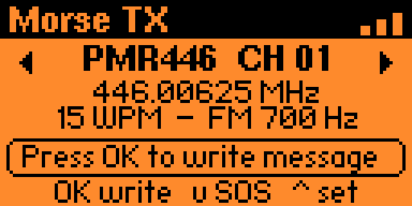
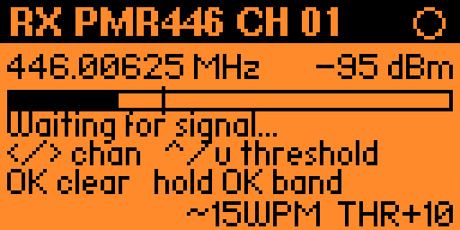

# MorseTX for Flipper Zero

--- TX

--- RX

MorseTX is a Flipper Zero application that allows you to transmit custom text or quick SOS messages in Morse code using the internal Sub-GHz radio module. It also includes a Receiver (RX) section for experimenting with CW and OOK Morse signal reception.

## Features

### Transmission (TX)

- **Text-to-Morse Conversion:** Type custom text directly on the Flipper Zero interface and convert it into Morse code.
- **Quick SOS:** Instantly transmit an SOS Morse sequence by pressing the Down button.
- **Multiple Frequency Bands:** Supports PMR446 (channels 1–16) and LPD433 (channels 1–69), subject to hardware and regional regulatory limitations.
- **Modulation Modes:**
  - **FM Tone:** Transmits a tone using frequency modulation.
  - **OOK Tone:** Uses On-Off Keying to transmit an audio-tone-based Morse signal.
  - **CW (OOK):** Transmits traditional keyed Morse signals using On-Off Keying.
- **Configurable Settings:** Adjust transmission speed in Words Per Minute (WPM) and select audio tone frequencies of 500 Hz, 700 Hz, or 1000 Hz.

### Receiver (RX)

- **CW Reception:** Supports receiving Morse signals transmitted using CW-style keying.
- **OOK Reception:** Supports receiving On-Off Keying signals for Morse code experimentation and decoding.
- **HackRF Tested:** The receiver functionality has been tested with a HackRF using a **500 Hz parameter setting**.
- **Integrated Receiver Interface:** Access the RX section directly from the application.
- **Experimental Decoding:** Receive and decode supported Morse signals, depending on the implementation, signal characteristics, and hardware limitations.

**Testing Note:** RX functionality has been tested with a HackRF using a 500 Hz setting. This describes the reported test configuration and does not guarantee compatibility with every transmitter, modulation scheme, or receiver setup. The exact meaning of the 500 Hz parameter depends on the configuration used during testing.

## How to Use

### 1. Main Interface

- Use the **Left** and **Right** arrow buttons to select the desired frequency band and channel.
- Press **OK** to transmit the current message. If the text box is empty, the application will prompt you to enter a custom message.
- Press **Down** to instantly transmit an SOS Morse sequence.
- Press **Up** to open the settings menu.
- Open the **Receiver (RX)** section to experiment with receiving CW and OOK Morse signals.

### 2. Settings Menu

- **Messaggio:** Opens the on-screen text input to change the transmission message.
- **Banda:** Switch between `PMR446` and `LPD433`.
- **Canale:** Select the desired channel index.
- **Velocita WPM:** Adjust the Morse transmission speed, starting at 5 WPM.
- **Modo:** Choose between `Tono FM`, `Tono OOK`, and `CW (OOK)`.
- **Tono:** Select the audio tone frequency for supported tone modes.

### 3. During Transmission

- The screen displays a progress bar indicating transmission status.
- The Flipper Zero blue LED remains solid blue during transmission, as implemented by the application.
- Press the **Back** button at any time to abort the transmission.

### 4. Receiver (RX) Operation

1. Open the Receiver (RX) section in the application.
2. Configure the receiver for the frequency and signal type supported by the implementation.
3. Receive CW or OOK Morse signals and observe the decoded output where supported.
4. For the reported HackRF test, the parameter was set to **500 Hz**.
5. Results may vary depending on signal strength, modulation, frequency deviation, receiver configuration, interference, and hardware limitations.

**Important:** Successful testing with a HackRF does not establish that the Flipper Zero's internal CC1101 can receive every type of CW or OOK signal. Reception depends on the actual implementation and the capabilities of the hardware.

## Supported Bands

- **PMR446:** Channels 1–16.
- **LPD433:** Channels 1–69.

Channel frequencies, permitted power levels, antenna requirements, and transmission permissions vary according to regional regulations and the applicable radio equipment rules. Selecting a channel in the application does not automatically make transmission on that channel legal.

## Technical Notes

- Morse text is converted into sequences of dots and dashes according to standard Morse code timing.
- WPM controls the transmission speed.
- Tone settings apply to the modulation modes that support an audio tone.
- CW (OOK) uses keyed carrier on/off periods rather than requiring a continuous audio tone.
- RX performance depends on the supported modulation, receiver configuration, signal quality, and hardware capabilities.
- The reported HackRF RX test used a 500 Hz parameter setting. The precise parameter should be documented alongside the test setup for reproducibility.

## Disclaimer

**IMPORTANT: This software is provided for educational, experimental, and amateur radio hobbyist purposes only.**

- Transmitting on restricted frequencies, including PMR446 or LPD433 bands, without the required authorization or outside applicable legal power and technical limits may violate local telecommunications regulations.
- Users are responsible for ensuring that all transmissions comply with the laws and regulations applicable in their jurisdiction.
- Receive and monitor signals only where permitted by applicable laws. Respect privacy and communications confidentiality requirements.
- The author and contributors assume no liability for misuse, legal consequences, interference, equipment damage, or other consequences arising from the use of this application.
- The application is provided "as is", without warranties of any kind.
- Receiver compatibility and decoding performance are not guaranteed for every signal, modulation, transmitter, or hardware configuration.
- Always use this software responsibly and ensure that any testing is performed in a lawful and controlled environment.

**By using MorseTX, you accept responsibility for complying with all applicable laws and regulations.**
